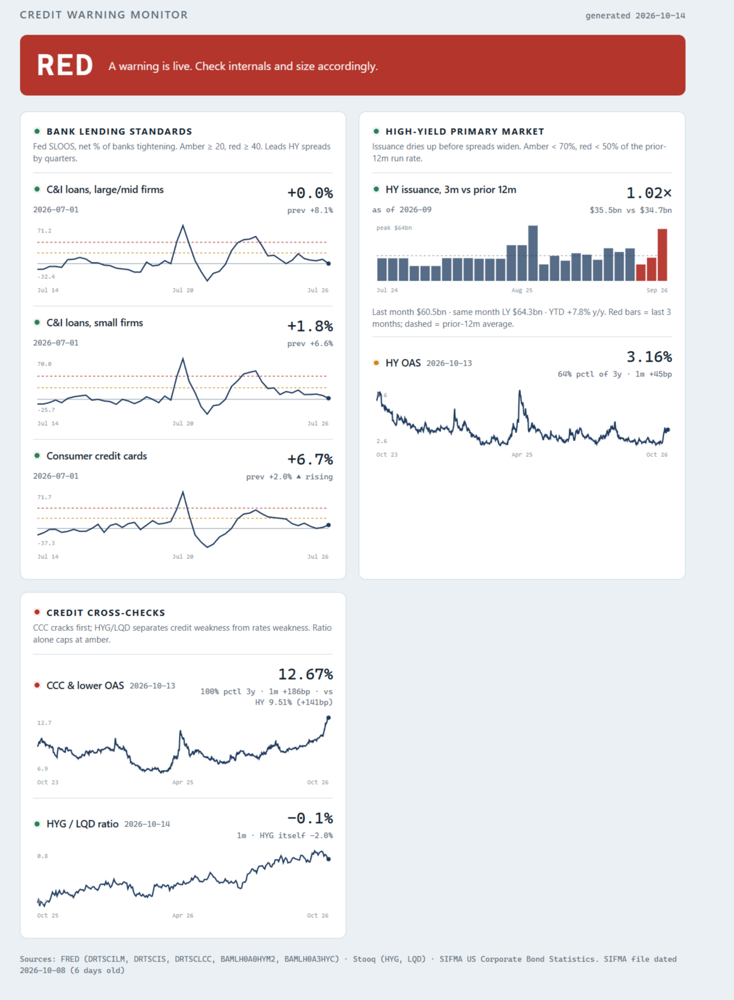

# Credit Warning Monitor

A Python tool that watches the **credit signals that tend to lead equity bear markets** (instead of the ones that only confirm them) and turns them into a one-page traffic-light dashboard.



*Live output from October 2026: the composite is RED because CCC spreads went above 1,200bp and decompressed sharply from the broader high-yield index. Lending standards and primary-market issuance stayed healthy, which makes this a "weakest-link" stress reading, not a broad credit turn.*

---

## Why this exists

Popular macro signals such as the yield-curve inversion either lag or have lost reliability since QE. Credit tends to give an earlier warning, in a fairly consistent order:

1. **Banks tighten lending standards.** This shows up in the Fed's Senior Loan Officer Survey (SLOOS) and historically leads high-yield spread widening by several quarters.
2. **The high-yield primary market quietly shuts.** New issuance dries up *before* secondary-market spreads move.
3. **The weakest credits crack first.** CCC spreads widen ahead of the headline index.

Most dashboards only track spreads, which is step 3 at index level. This tool watches all three steps. It also separates **credit-driven** weakness from **rates-driven** weakness, because high-yield ETFs can fall just because Treasury yields rose.

## What it measures

| Leg | Signal | Source | Frequency | AMBER / RED rule |
|---|---|---|---|---|
| **Lending standards** | Net % of banks tightening: C&I (large/mid and small firms) and credit cards | FRED (`DRTSCILM`, `DRTSCIS`, `DRTSCLCC`) | Quarterly | ≥ 20% / ≥ 40%; momentum upgrade on a fast rise from a low base |
| **HY primary market** | 3-month HY issuance run-rate vs prior 12-month average | SIFMA US Corporate Bond Statistics | Monthly | < 70% / < 50% of run-rate; **"quiet shutdown" flag** if issuance collapses while spreads still look benign |
| | HY option-adjusted spread, 3-year percentile | FRED (`BAMLH0A0HYM2`) | Daily | Context for the issuance leg |
| **Cross-checks** | CCC & lower OAS: 1-month change and decompression vs headline HY | FRED (`BAMLH0A3HYC`) | Daily | +75bp / +150bp (CCC); +50bp / +100bp (CCC minus HY) |
| | HYG/LQD ratio: credit vs rates attribution | Stooq, Yahoo fallback | Daily | ≤ −1.5% in 1 month → AMBER (capped, because it is noisy on its own) |

The **composite** is the worst of the three legs. Every threshold is a named constant at the top of the script, so you can tune them.

## Design notes

These are the problems that took the most work:

- **Parsing a messy institutional workbook.** SIFMA's issuance sheet mixes annual totals, YTD rows, quarterly rows (`2Q26`) and monthly datetimes in a single column. A naive date coercion turned integer years into dates and produced a **false RED** (an apparent 50% issuance collapse). The parser now classifies each row type explicitly. It also fills in older months from the quarterly totals, so the 12-month baseline still has data even though SIFMA only publishes ~13 months of monthly figures.
- **Data revisions are part of the signal.** SIFMA's latest one or two months print soft and are revised up as the underlying data settles. In one release a sharp July–August slump was revised up by about 50%. The latest month is best read with caution.
- **Separating rates from credit.** When HYG falls, the HYG/LQD ratio shows whether high yield is underperforming investment grade (credit risk being repriced) or falling in line with it (duration). The dashboard labels the driver automatically.
- **Mixed data frequencies on one page.** Quarterly, monthly and daily series sit side by side. Each card shows its own as-of date, and chart axes switch between year labels and month labels depending on the time span. Without that, a 12-year quarterly chart can be misread as days within one month.
- **Robust data fetching.** No API keys are needed. FRED's public CSV endpoint supplies the macro series. ETF prices come from Stooq, with a browser user agent (Stooq rejects bare scripts), a mirror, and a Yahoo fallback.

## Setup

Requires Python 3.10+.

**Windows (Git Bash)**
```bash
git clone https://github.com/<your-username>/credit-warning-monitor.git
cd credit-warning-monitor
python -m venv .venv
```
```bash
source .venv/Scripts/activate
python -m pip install -r requirements.txt
```

**macOS / Linux**
```bash
python3 -m venv .venv && source .venv/bin/activate
pip install -r requirements.txt
```

### Getting the issuance data

SIFMA's download is behind a free registration form, so the workbook is fetched by hand and is **not included in this repo**:

1. Go to [SIFMA → US Corporate Bonds Statistics](https://www.sifma.org/research/statistics/us-corporate-bonds-statistics) and click **Download**.
2. Choose **US Corporate Bond Statistics**.
3. Save the `.xlsx` into the project folder.

SIFMA updates it in the first week of each month. Without it, the issuance leg reports `UNKNOWN` and the other legs still run.

## Usage

```bash
# Terminal summary
python credit_warning_monitor.py --sifma-file US-Corporate-Bonds-Statistics-SIFMA.xlsx

# HTML dashboard, opened in the browser
python credit_warning_monitor.py --sifma-file US-Corporate-Bonds-Statistics-SIFMA.xlsx --html report.html --open

# JSON snapshot for other tools
python credit_warning_monitor.py --sifma-file US-Corporate-Bonds-Statistics-SIFMA.xlsx --json latest.json

# Your own issuance series instead of SIFMA (CSV with columns: date,volume in $bn)
python credit_warning_monitor.py --hy-csv my_issuance.csv
```

Example terminal output:
```
3) CREDIT CROSS-CHECKS
   CCC OAS 12.67%  (100% pctl 3y, 1m +186bp)  vs HY 9.51% (+141bp 1m)  [RED]
   HYG/LQD 1m -0.1%  (HYG -2.0%)  [GREEN]
   -> overall: RED
```

### Scheduling (Windows)

`run_monitor.bat` regenerates `report.html` and `latest.json` and writes a log. To run it every day, point a **Task Scheduler** basic task at it. The FRED and price data refresh on each run. The dashboard footer warns when the SIFMA file is more than 40 days old.

## Tests

The tests run offline and do not need the network or real SIFMA data. They build a synthetic workbook that copies SIFMA's layout.

```bash
python -m pip install -r requirements-dev.txt
python -m pytest -q
```

They cover the mixed-row workbook parser, the issuance scoring and the quiet-shutdown flag, the CCC and HYG/LQD cross-checks with their driver labels, and the chart-axis formatting.

## Limitations

- **Thresholds are judgement-based and have not been backtested.** A natural next step is to calibrate them against past drawdowns (2000, 2007, 2015–16, 2018, 2020, 2022), counting both hits and false alarms.
- **FRED now publishes only about 3 years of ICE BofA spread history**, so "100th percentile" means the highest level in the available window, not an all-time high.
- **The CCC index mixes performing and distressed bonds.** A few large names entering distress can move it more than broad repricing would.
- **SLOOS is quarterly.** It is the slowest signal on the board and also the one with the most lead time.

## Project structure

```
credit_warning_monitor.py   # fetchers, evaluators, HTML renderer, CLI
run_monitor.bat             # Windows scheduler entry point
tests/test_monitor.py       # offline unit tests
docs/dashboard.png          # screenshot used above
```

---

*Not investment advice. Built for personal research into credit-cycle dynamics.*
